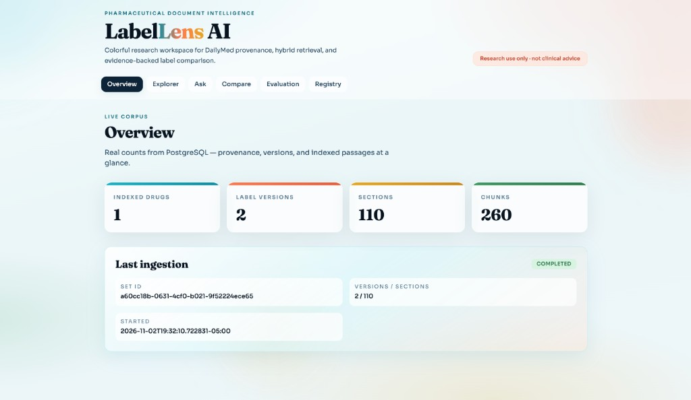
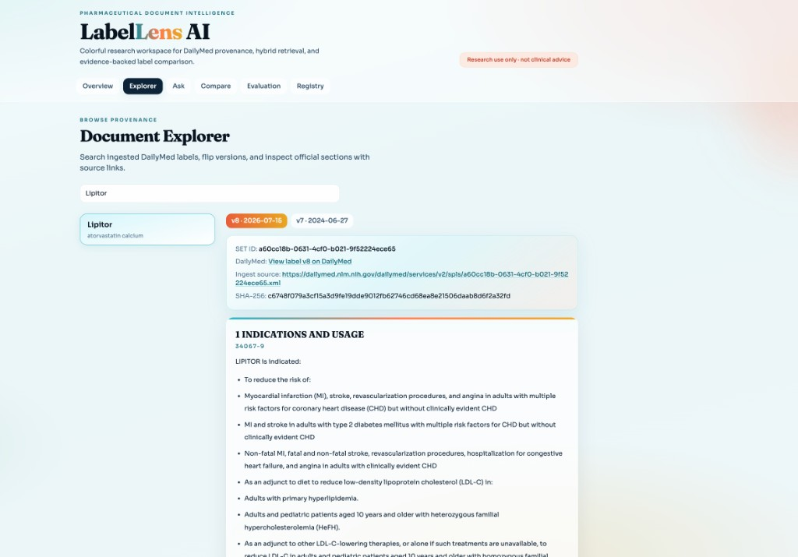
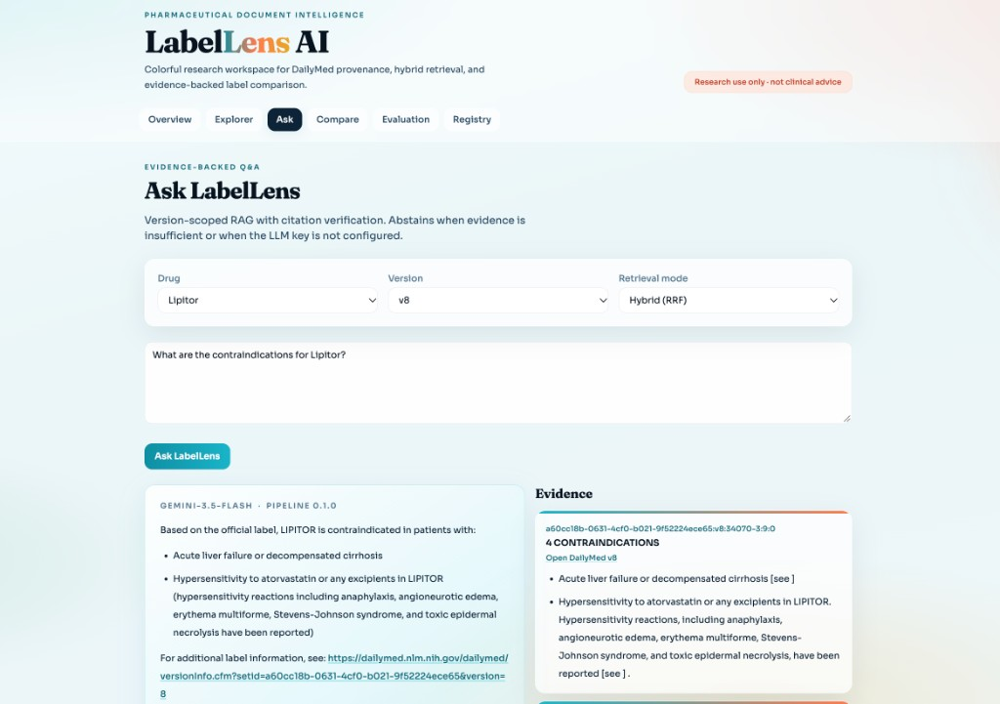
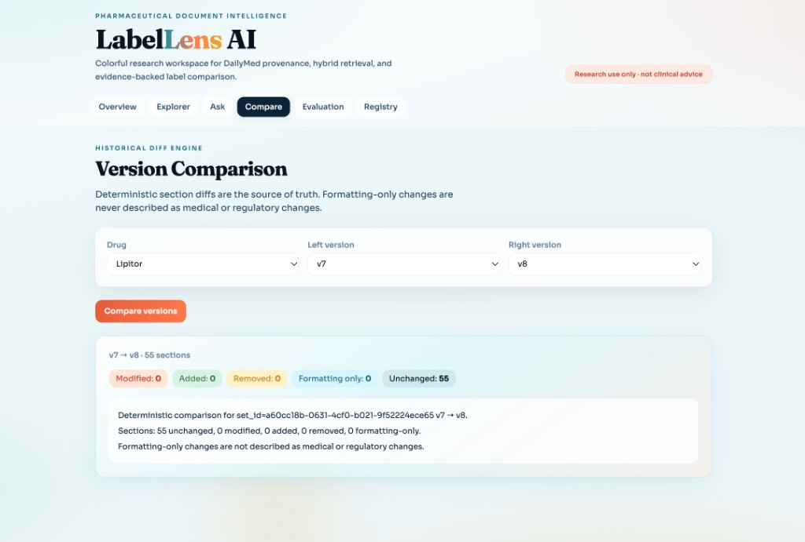
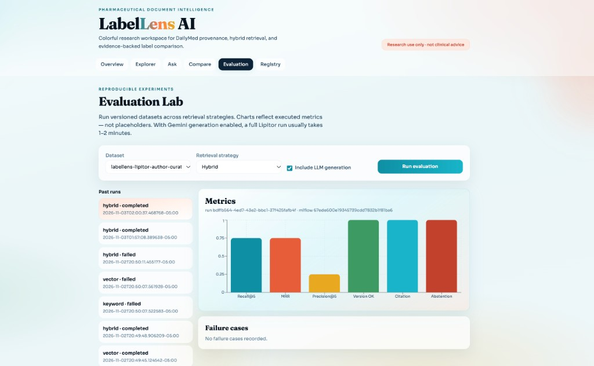
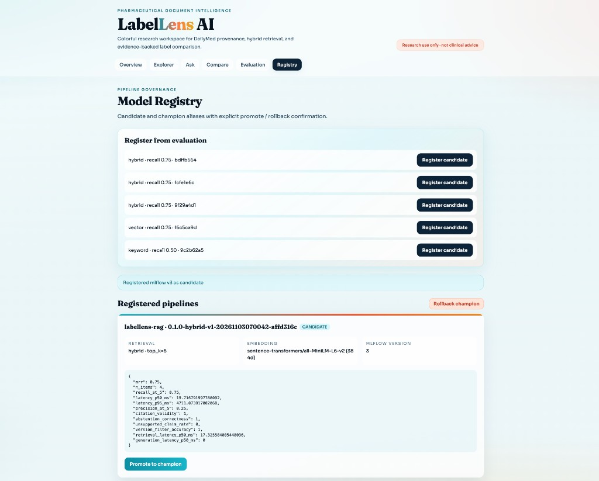
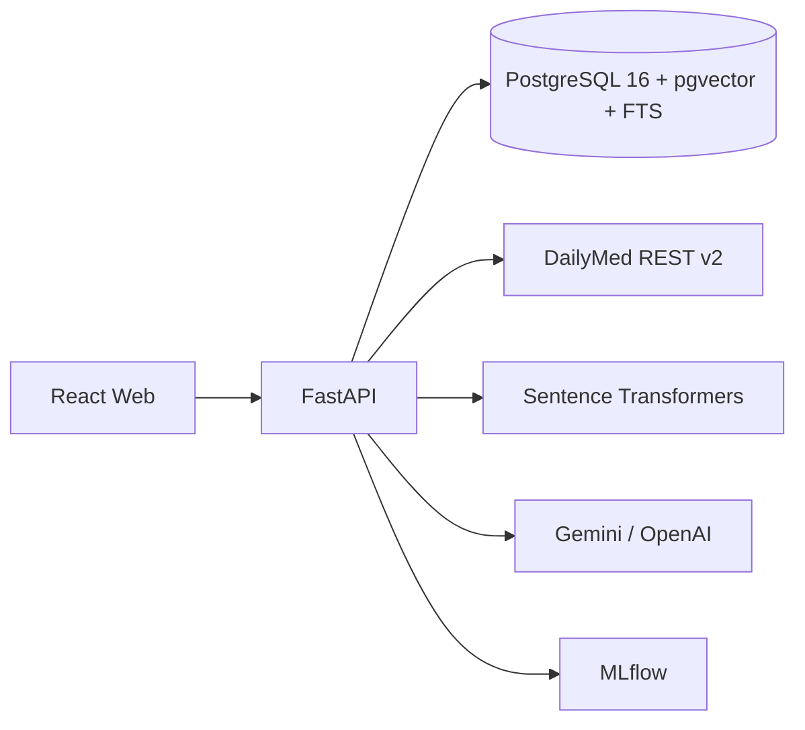

# LabelLens AI

**Author:** [Sovit Bhandari](https://github.com/sovitbhandari)

Version-aware pharmaceutical document intelligence for official DailyMed Structured Product Labeling (SPL) documents.

LabelLens is **not** a generic PDF chatbot and **not** a clinical decision-support system. It is a research platform for ingestion, version-preserving retrieval, evidence-backed answers, and deterministic historical label comparison.

> Research use only — not clinical advice.

## Screenshots

### Overview



### Document Explorer



### Ask (evidence-backed Q&A)



### Version Comparison



### Evaluation Lab



### Model Registry



## Product problem

Drug labels change over time. Researchers need:

1. Immutable historical versions with provenance
2. Answers grounded in exact passages with citations
3. Deterministic diffs between versions (an LLM may summarize observed diffs, never invent changes)
4. Measurable retrieval and generation quality tracked in MLflow

## Features

| Area | Status |
|------|--------|
| DailyMed search / history / XML+ZIP ingestion | Implemented |
| Immutable versions + hash mismatch flags | Implemented |
| Section parsing + section-aware chunking | Implemented |
| Keyword + vector + hybrid (RRF) retrieval | Implemented |
| RAG answers with citation verification | Implemented (`GEMINI_API_KEY` or `OPENAI_API_KEY`; evidence-only fallback otherwise) |
| Historical comparison engine | Implemented (Lipitor v7→v8) |
| Evaluation lab + MLflow registry | Implemented |
| React dashboard | Implemented (6 pages) |
| AWS deployment | Config skeleton only — **not deployed** |

See [`PROGRESS.md`](PROGRESS.md) for verification notes.

## Architecture



## Technology choices

- **Backend:** Python 3.12, FastAPI, SQLAlchemy 2, Alembic, Pydantic v2
- **Retrieval:** PostgreSQL full-text search, pgvector cosine distance, Reciprocal Rank Fusion
- **Embeddings:** `sentence-transformers/all-MiniLM-L6-v2` (384-d) by default
- **Generation:** Gemini or OpenAI structured JSON; citations validated against retrieved passage IDs
- Core RAG is explicit and testable (no LangChain dependency for the main path)

## Data sources

Official DailyMed API:

- `GET /services/v2/spls.json?drug_name=...`
- `GET /services/v2/spls/{SETID}/history.json`
- `GET /services/v2/spls/{SETID}.xml` (current)
- `GET /dailymed/getFile.cfm?type=zip&setid=...&version=...` (historical)

Demo label: Lipitor SET ID `a60cc18b-0631-4cf0-b021-9f52224ece65`.

Fixtures under `datasets/fixtures/`:

- `lipitor_v8_REAL.xml` — real downloaded SPL
- `synthetic_fakedrug_v1.xml` — **SYNTHETIC** test-only content

## Local setup

### 1. Environment

```bash
cp .env.example .env
# Optional: set GEMINI_API_KEY (preferred) or OPENAI_API_KEY for generative answers
```

### 2. Databases

```bash
docker compose up -d db
docker compose exec db psql -U labellens -d labellens_test -c 'CREATE EXTENSION IF NOT EXISTS vector; CREATE EXTENSION IF NOT EXISTS pg_trgm;'
```

### 3. API install and migrate

```bash
cd apps/api
poetry env use python3.12
poetry install
poetry run alembic upgrade head
```

### 4. Ingest demo label

```bash
cd ../..
poetry -C apps/api run python scripts/ingest_demo.py
```

### 5. Run API

```bash
cd apps/api
poetry run uvicorn app.main:app --reload --port 8000
```

### 6. Run web

```bash
cd apps/web
npm install
npm run dev
```

Admin endpoints require header: `X-Admin-Token: <ADMIN_TOKEN from .env>`.

## Retrieval strategy

1. **Keyword:** `plainto_tsquery` + `ts_rank_cd` on section title (A) + body (B)
2. **Vector:** exact cosine distance (`<=>`) filtered by embedding model + dimension
3. **Hybrid:** Reciprocal Rank Fusion with configurable `RRF_K`

Version isolation is mandatory: queries always filter `set_id` + `spl_version`.

## Historical comparison

Deterministic `difflib` section alignment is the source of truth. An LLM may summarize observed diffs only.

## Security considerations

- No secrets in the browser client
- Admin token for ingestion / evaluation / promotion
- Retrieved text treated as untrusted input to the generator
- Never invent clinical facts; abstain when evidence is insufficient

## Known limitations

- Without `GEMINI_API_KEY` or `OPENAI_API_KEY`, answers fall back to evidence-only abstention
- ANN indexes are not enabled yet (small corpus; exact search measured first)
- AWS configs are skeletons only — not deployed
- Not for patient-specific clinical decisions

## Author

**Sovit Bhandari** — sole author and maintainer of this repository.

## License / disclaimer

Portfolio research software. Label content © respective labelers / FDA DailyMed. Do not use for medical advice.
