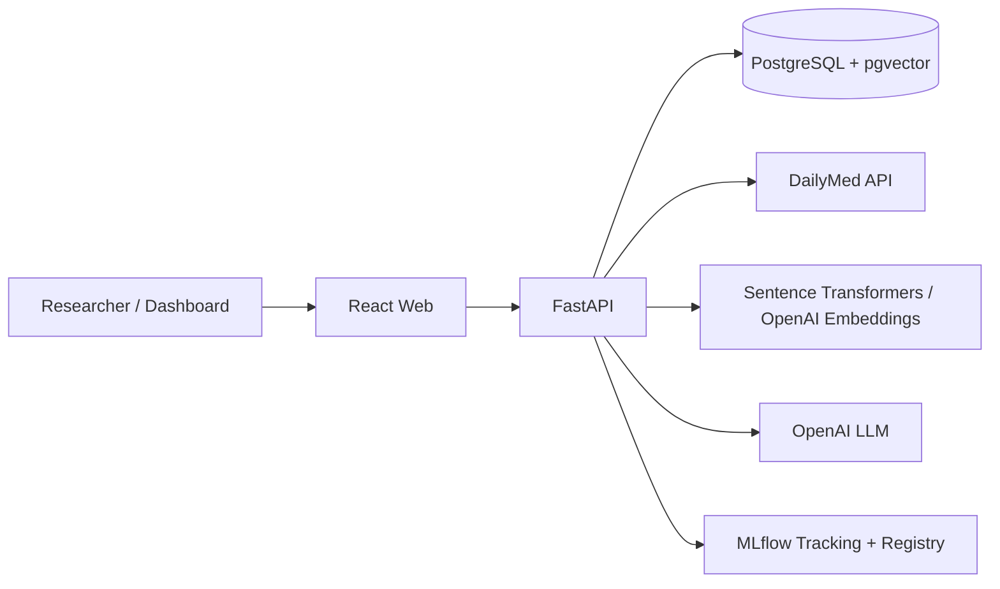
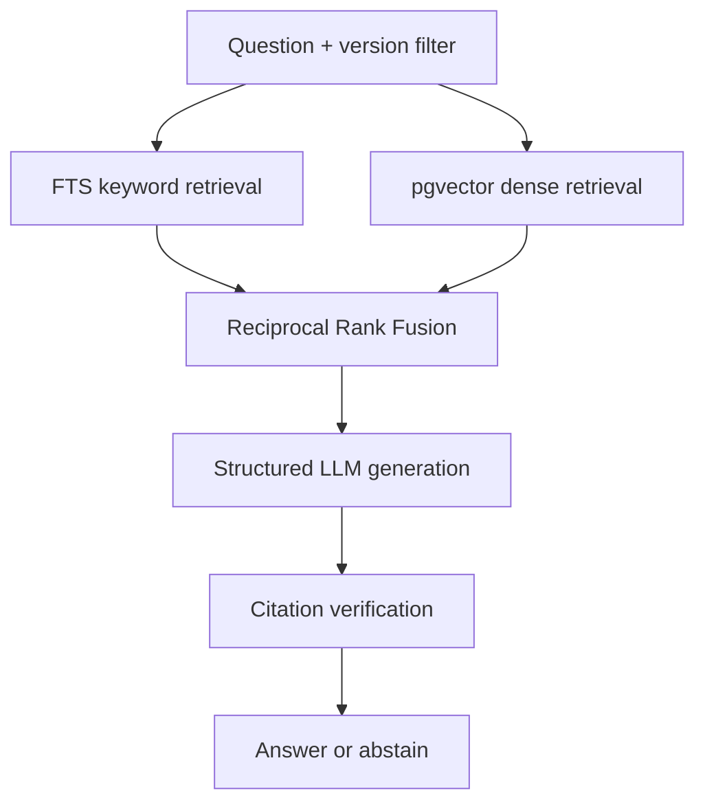

# LabelLens AI — Architecture

## Product problem

Pharmaceutical labeling documents change over time. Researchers need version-aware retrieval, evidence-backed answers, and deterministic historical diffs — not a generic PDF chatbot.

## System context



## Data flow — ingestion

```mermaid
sequenceDiagram
  participant API
  participant DM as DailyMed
  participant DB as PostgreSQL
  API->>DM: search / history / XML or ZIP
  DM-->>API: SPL metadata + document
  API->>API: parse sections, checksum
  API->>DB: upsert drug/label; insert immutable version
  Note over DB: hash mismatch on existing version = flag, never overwrite
```

## Data flow — RAG



## Version isolation rule

Retrieval never crosses label versions unless the caller explicitly requests comparison or cross-version analysis. Every chunk references exact `(set_id, spl_version, section_id)`.

## Key design decisions

See [decision-log.md](./decision-log.md).
